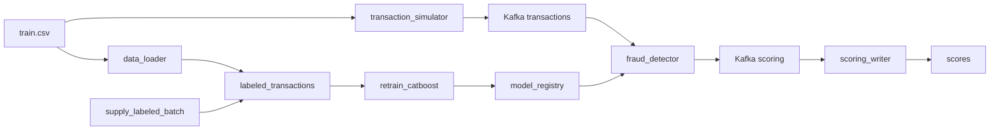

# Антифрод: поток транзакций, скоринг и переобучение

Учебный проект обнаружения мошеннических транзакций. Kafka несёт непрерывный поток событий, CatBoost скорит их текущей моделью, а Airflow по расписанию дописывает размеченные месяцы и переобучает модель.

Датасет можно найти [здесь](https://www.kaggle.com/competitions/teta-ml-1-2025/data). В этом занятии используется файл `train.csv` из каталога практики занятия 07. Путь задаётся переменной `TRAIN_DATA_CSV`.

---

## Архитектура



| Сервис | Описание |
|--------|----------|
| **Kafka** | Шина сообщений между симулятором потока, скорингом и записью результатов |
| **Zookeeper** | Управление кластером Kafka |
| **Kafka UI** | Просмотр топиков `transactions` и `scoring` |
| **transaction_simulator** | Бесконечно шлёт в `transactions` случайные строки CSV. У каждой новый `transaction_id` и `transaction_time`, равный текущему моменту, формат `YYYY-MM-DD HH:MM` |
| **fraud_detector** | Препроцессинг и инференс CatBoost. Перед каждым сообщением читает `/models/latest.txt` и подхватывает `my_catboost_<версия>.cbm` без перезапуска |
| **scoring_writer** | Читает топик `scoring` и пишет `score`, `fraud_flag` и `model_version` в PostgreSQL |
| **PostgreSQL** | Витрина `labeled_transactions`, состояние окна `training_state` и таблица `scores` |
| **data_loader** | При старте один раз загружает весь CSV в витрину и собирает исходное окно обучения: январь–март 2019 |
| **airflow** | Поставка размеченного месяца каждые 5 минут и переобучение CatBoost каждую минуту |
| **Prometheus** | Собирает метрики скоринга, writer и Node Exporter каждую секунду |
| **Grafana** | Автоматически подключает Prometheus и загружает три дашборда из JSON |
| **Node Exporter** | Отдаёт системные метрики CPU, памяти, сети и дисков |

Общий том `model_registry` смонтирован в Airflow как `/opt/airflow/models` и в `fraud_detector` как `/models`. Логика задач вынесена в `pipeline/`. Файлы в `dags/` только связывают задачи.

---

## Структура проекта

```
.
├── fraud_detector/           # Онлайн-скоринг
├── transaction_simulator/    # Непрерывная поставка транзакций в Kafka
├── scoring_writer/           # Запись скоров в PostgreSQL
├── data_loader/              # Первичная загрузка размеченной витрины
├── dags/
│   ├── retrain_catboost.py   # DAG переобучения
│   └── supply_labeled_batch.py
├── pipeline/
│   ├── db.py                 # Подключение к витрине и training_state
│   ├── retrain/              # Функции задач переобучения
│   └── supply/               # Функции задач поставки месяца
├── airflow/                  # Образ Airflow с CatBoost
├── prometheus/prometheus.yml # Цели сбора метрик, интервал 1 секунда
├── grafana/
│   ├── provisioning/         # Источник Prometheus и загрузчик дашбордов
│   └── dashboards/           # Три дашборда, экспортированные из Grafana
├── docker-compose.yaml
├── .env.example
└── README.md
```

---

## Что происходит после запуска

1. `data_loader` копирует `TRAIN_DATA_CSV` в `labeled_transactions` и сохраняет окно января–марта 2019. Повторный старт без `down -v` витрину не перезаливает.
2. `transaction_simulator` каждые 0.1 секунды отправляет в Kafka случайную транзакцию с текущим временем.
3. `fraud_detector` скорит поток моделью из общего каталога. Если модель ещё не опубликована, он ожидает её до 10 минут. В текущем репозитории исходного `.cbm` нет: первую модель обучает Airflow при запуске. Если положить готовую модель в `fraud_detector/models/my_catboost.cbm` до сборки образа, она будет использована как версия `initial`.
4. `scoring_writer` складывает результат в `scores`, включая `model_version`.
5. DAG `supply_labeled_batch` каждые 5 минут берёт из витрины до 1000 случайных строк (`SAMPLE_SIZE` в `pipeline/settings.py`), переносит их время в следующий календарный месяц и дописывает батч. Наблюдения старше трёх лет относительно самого нового месяца удаляются.
6. DAG `retrain_catboost` каждую минуту забирает следующий месяц витрины, начиная с апреля 2019, сдвигает трёхмесячное окно, учит CatBoost и при прохождении проверки качества публикует `my_catboost_<timestamp>.cbm`.

Переобучение и поставка идут по разным указателям месяца. `retrain_catboost` читает исторические месяцы с апреля 2019. `supply_labeled_batch` каждый раз создаёт месяц после максимальной даты витрины, первый такой месяц — апрель 2020. Окно обучения ещё долго не доходит до этих батчей, и очистка трёх лет его не затрагивает.

Оба DAG можно запустить вручную в Airflow, не дожидаясь расписания. Если очередного месяца в витрине ещё нет, задачи переобучения помечаются как skipped.

---

## Технологии

- **Python 3.11**
- **ML**: CatBoost, pandas, numpy
- **Kafka**: потоковая обработка данных
- **PostgreSQL**: витрина размеченных данных и результаты скоринга
- **Airflow 2.10**: поставка месячных батчей и переобучение модели
- **Docker / Docker Compose**: оркестрация микросервисов
- **Prometheus / Grafana / Node Exporter**: сбор метрик и дашборды

---

## Как запустить проект

### 1. Подготовьте окружение

Клонируйте репозиторий этой работы и откройте терминал в его корне — каталоге,
где лежит `docker-compose.yaml`. Далее все команды выполняются из него.
Нужны работающий Docker Engine с Docker Compose v2+ либо запущенный Docker Desktop,
а также размеченный `train.csv` по ссылке в начале README.

На хосте должны быть свободны порты `2181`, `5432`, `9095`, `8080`, `8081`,
`8000`, `8001`, `9090` и `3000`.

### 2. Создайте `.env` файл

```bash
cp .env.example .env
```

В `TRAIN_DATA_CSV` укажите **абсолютный путь к существующему файлу** `train.csv`
на вашей машине. Если в пути есть пробелы, оставьте кавычки:

```dotenv
TRAIN_DATA_CSV="/absolute/path/to/train.csv"
FRAUD_DETECTOR_PROM_PORT=8000
SCORE_WRITER_PROM_PORT=8001
FRAUD_DETECTOR_THRESHOLD=0.9
```

Остальные значения скопируйте из `.env.example`. Порты `8000` и `8001`
совпадают с целями в `prometheus/prometheus.yml` и маппингами Compose.
Если `.env` остался от предыдущего задания, добавьте в него новые переменные
портов и порога. Общая переменная `METRICS_PORT` из `.env` перекрывается
отдельным значением для каждого сервиса в Compose.

### 3. Запустите контейнеры

```bash
docker compose config --quiet
docker compose up -d --build
docker compose ps -a
```

Первый запуск скачивает образы, загружает CSV в PostgreSQL и обучает первую
модель. Это занимает несколько минут. `kafka-setup` и `data_loader` должны
завершиться с кодом `0`: это одноразовые задачи. Остальные сервисы должны работать.

Проверить загрузку и начало скоринга:

```bash
docker compose logs --tail=50 airflow fraud_detector scoring_writer transaction_simulator
```

Airflow автоматически запускает обучение, если `/opt/airflow/models/latest.txt`
ещё отсутствует. До публикации первой модели скоринг ожидает её, поэтому его
цель в Prometheus временно может быть `DOWN`. Если обучение не началось,
откройте Airflow и вручную запустите `retrain_catboost`.

## Доступные сервисы

| Сервис | URL |
|--------|-----|
| **Kafka UI** | http://localhost:8080 |
| **Airflow** | http://localhost:8081 (`admin` / `admin`) |
| **Grafana** | http://localhost:3000 (`admin` / `admin` при первом запуске) |
| **Prometheus** | http://localhost:9090 |
| **Метрики скоринга** | http://localhost:8000/metrics |
| **Метрики writer** | http://localhost:8001/metrics |
| **PostgreSQL** | `localhost:5432`, база `fraud_db` |

Пользователь и пароль Postgres задаются в `.env` (`fraud_user` / `fraud_pass` в шаблоне).

Посмотреть витрины из контейнера:

```bash
docker compose exec postgres psql -U fraud_user -d fraud_db
```

---

## Дашборды и provisioning

В Grafana откройте **Dashboards**. Три дашборда появляются автоматически
в общем списке, без импорта JSON через интерфейс:

| Дашборд | Прямая ссылка | Панели |
|--------|---------------|--------|
| **Fraud statistics** | http://localhost:3000/d/ad29kxz | `Fraud rate`, `Transactions per second`, `Seconds per transaction scoring`, `Fraud scores distribution`; аннотация `Смена модели` |
| **Scoring writer statistics** | http://localhost:3000/d/adtkbkk | `Fraud detected`, `Writes per second`, `Write duration distribution in seconds`, `Written scores distribution`, `Write duration: mean and p95` |
| **Node Metrics** | http://localhost:3000/d/node-metrics | `CPU Utilization`, `Memory Utilization`, `Network Traffic`, `Disk I/O` |

Обновление — каждую секунду, начальный диапазон — последние 15 минут.
На графиках скорости и распределений сразу после запуска нужно несколько
успешных сборов метрик. Для проверки устойчивого потока подождите около минуты.

Файлы настроек:

- `grafana/provisioning/datasources/prometheus.yaml` создаёт источник
  `Prometheus` с адресом `http://prometheus:9090`, UID `fg3x097p7l3i8c`
  и интервалом сбора `1s`. Этот UID совпадает со ссылками в трёх JSON.
- `grafana/provisioning/dashboards/dashboards.yaml` загружает JSON из
  `/var/lib/grafana/dashboards` и проверяет изменения примерно каждые 20 секунд.
- `grafana/dashboards/*.json` содержат экспортированные панели и PromQL-запросы.

Редактирование через UI разрешено, но оно меняет только внутреннюю БД Grafana.
После правок экспортируйте дашборд как **Classic JSON** и замените файл
в репозитории. Сохраняйте UID источника; экспорт для внешнего обмена с подменой
источников на входные параметры для этого запуска не нужен.
После изменения YAML provisioning примените настройки:

```bash
docker compose restart grafana
```

Логин и пароль `admin` / `admin` относятся к новой установке. Если пароль
уже меняли, Grafana сохранит его в томе `grafana_data`.

## Список метрик

### Скоринг: `fraud_detector:8000/metrics`, job `fraud_detector`

| Метрика | Назначение и панель |
|---------|--------------------|
| `scoring_transactions_processed_total` | Счётчик успешно обработанных транзакций; `rate` используется в `Transactions per second` |
| `transaction_processing_seconds_sum`, `transaction_processing_seconds_count` | Суммарное время и число вызовов обработки; отношение их `rate` даёт среднее время в `Seconds per transaction scoring`. Учитываются и неудачные попытки |
| `fraud_score_bucket`, `fraud_score_sum`, `fraud_score_count` | Гистограмма скоров; нормализованная heatmap `Fraud scores distribution` |
| `fraud_ratio` | Доля фрода среди успешно обработанных транзакций с запуска процесса; панель `Fraud rate` |
| `model_version_updates_total{version="..."}` | Счётчик смены версии модели; аннотация `Смена модели` на графиках, включая heatmap |

Порог фрода задаётся `FRAUD_DETECTOR_THRESHOLD` в `.env` (по умолчанию в шаблоне
`0.9`); `fraud_flag = 1`, если скор **строго больше** порога.

### Запись: `scoring_writer:8001/metrics`, job `scoring_writer`

| Метрика | Назначение и панель |
|---------|--------------------|
| `scoring_writer_scores_written_total` | Число скоров после успешного commit; `rate` в `Writes per second` |
| `scoring_writer_write_duration_seconds_bucket`, `_sum`, `_count` | Время INSERT и commit одной успешной записи; heatmap `Write duration distribution in seconds`, среднее и p95 в `Write duration: mean and p95` |
| `scoring_writer_fraud_written_total` | Число успешно записанных транзакций с `fraud_flag = 1`; `Fraud detected` |
| `scoring_writer_score_bucket`, `_sum`, `_count` | Гистограмма всех сохранённых скоров; `Written scores distribution` |

Счётчики и гистограммы накапливаются с запуска процесса и сбрасываются при
перезапуске; это не полное число строк за всю историю PostgreSQL.
Время измеряется в секундах. Бакеты скоров идут от 0 до 1 с шагом 0.01.
Heatmap показывает **долю наблюдений** в каждом интервале за скользящее окно:
бакеты делятся на `_count` за то же окно, затем Grafana преобразует
накопительные бакеты в отдельные интервалы. Цвет `0.1` означает 10% наблюдений.
При отсутствии потока нормализованная доля не определена — это может давать пропуски.

### Система: `node-exporter:9100/metrics`, job `node`

| Метрики | Панель |
|---------|--------|
| `node_cpu_seconds_total` | `CPU Utilization`, использование CPU в процентах |
| `node_memory_MemAvailable_bytes`, `node_memory_MemTotal_bytes` | `Memory Utilization`, использование памяти в процентах |
| `node_network_receive_bytes_total`, `node_network_transmit_bytes_total` | `Network Traffic`, приём и передача в байт/с |
| `node_disk_read_bytes_total`, `node_disk_written_bytes_total` | `Disk I/O`, чтение и запись в байт/с |

Node Exporter читает `/proc` и `/sys`. Конфигурация bind mounts рассчитана
на Linux. На macOS Docker Desktop работает через Linux VM, поэтому эти
показатели не следует трактовать как метрики самой macOS. В bridge-сети
сетевые счётчики относятся к сетевому namespace Node Exporter, а не к трафику
каждого сервиса. Нулевая скорость дискового ввода-вывода при простое допустима.

## Дополнительные метрики скоринга

- Число фрода в минуту - считается на основе Prometheus Counter метрики `scoring_fraud_transactions_total`.
Нужна как алерт: резкий рост говорит либо о фродовой атаке на банк, либо модель сошла сума.
Смотреть в дашборде **`Fraud statistics`**
- Число пограничных решений - считается на основе Prometheus Counter метрики `scoring_near_threshold_total`. 
Смотреть в дашборде **`Fraud statistics`**
Нужна для отслеживания пограничных решений (по дефолту `abs(score − threshold) < 0.05`) и принятия решений об изменении порога фрода

## Таблицы PostgreSQL

Таблица `scores`:

| Поле | Тип | Описание |
|------|-----|----------|
| id | SERIAL | Уникальный ID |
| transaction_id | TEXT | Идентификатор транзакции |
| score | FLOAT | Скор мошенничества от 0 до 1 |
| fraud_flag | INT | 1, если score больше `FRAUD_DETECTOR_THRESHOLD`, иначе 0 |
| model_version | TEXT | Версия CatBoost, которая посчитала скор |
| created_at | TIMESTAMP | Время записи |

`labeled_transactions` — витрина размеченных транзакций. `training_state` хранит границы трёхмесячного окна обучения и месяц следующего батча.

Последние скоры:

```sql
SELECT transaction_id, score, fraud_flag, model_version, created_at
FROM scores
ORDER BY created_at DESC
LIMIT 20;
```

Модели, которые опубликовал DAG:

```bash
docker compose exec airflow ls -la /opt/airflow/models
```

---

## Data Quality датасета

DAG `data_quality` (каждые 5 минут) проверяет текущий датасет обучения
`current.parquet` и публикует HTML-отчёт в `/opt/airflow/dq_reports`
(том `dq_reports`, рядом с каталогом моделей).

Минимальный набор правил DQ:
1. Датасет не пустой (`rows > 0`).
2. Нет пропусков в критичных колонках: `transaction_time`, `target`, `amount`, `merch`, `cat_id`.
3. `target` принимает только значения `0` или `1`.
4. `amount >= 0`.
5. `transaction_time` валиден и покрывает ровно 3 календарных месяца.
6. Нет точных дублей строк.
7. Доля фрода в диапазоне `[0.001, 0.2]`.
8. Категориальные поля (`merch`, `gender`, `us_state`, `jobs`) непустые.

Отчёт читать:
```bash
docker compose exec airflow ls -la /opt/airflow/dq_reports
docker compose exec airflow cat /opt/airflow/dq_reports/latest.html
```
Или через браузер на хосте после копирования файла из контейнера.

## Как смотреть демонстрацию

### 1. Проверить сбор метрик и рост потока

Откройте http://localhost:9090/targets. Цели `fraud_detector:8000`,
`scoring_writer:8001` и `node-exporter:9100` должны быть `UP`.
В интерфейсе Prometheus выполните:

```promql
up
scoring_transactions_processed_total
scoring_writer_scores_written_total
```

Счётчики должны увеличиваться при повторном запросе через несколько секунд.
То же можно проверить на страницах `/metrics`, перечисленных выше.
В Kafka UI топик `transactions` пополняется примерно каждые 0.1 секунды,
топик `scoring` — ответами модели. В первых двух дашбордах ожидается положительная
скорость, заполненные heatmap и время обработки/записи. Фрод может быть равен
нулю на коротком промежутке; это не ошибка, если фрод-транзакции не поступали.

### 2. Проверить публикацию и отметку новой версии

Сначала дождитесь работающего скоринга, затем запомните активную версию:

```bash
docker compose exec airflow cat /opt/airflow/models/latest.txt
```

В http://localhost:8081 откройте DAG `retrain_catboost`, нажмите **Trigger DAG**
и дождитесь завершения `publish_model`. DAG также запускается каждую минуту.
Повторите команду чтения `latest.txt`: версия должна измениться.

Важно: успешное обучение не всегда меняет активную модель. Если качество
хуже базовой модели, `publish_model` сохраняет артефакт, но не меняет `latest.txt`.
Проверьте логи задачи и следующий прогон. Если следующего месяца в витрине нет,
DAG пропустит обучение. Само переобучение в этой работе отдельно не оценивается,
но для демонстрации нужна действительно опубликованная новая версия.

После следующей транзакции скоринг загрузит новый файл без перезапуска.
На дашборде **Fraud statistics**, в том числе поверх heatmap, появится красная
аннотация **Смена модели**. Наведите на неё курсор: заголовок
`Модель <version>`, текст `Скоринг перешёл на <version>`.
Область события охватывает примерно 30 секунд и затем остаётся в истории
выбранного диапазона времени. На дашборде переключатель **Смена модели** должен
быть включён. Первая загрузка модели при запуске процесса не считается сменой.
Контейнер `fraud_detector` для этой проверки не перезапускайте.

Проверить счётчик можно запросом:

```promql
model_version_updates_total
```

Он появится после первой смены версии. Отсутствие аннотации до смены модели
нормально. Даты в UID версии модели формируются в UTC, а Grafana показывает
ось времени в часовом поясе браузера.

### Если панели пустые

- `UP = 0`: проверьте `docker compose ps -a` и логи нужного сервиса. Первую минуту метрик может не быть, потому что еще нет файла актуальной модели.
- Метрики есть, но скорость ещё пуста: подождите несколько успешных сборов
  и выберите последние 15 минут, убедитесь, что симулятор работает..

### Очистка

Остановить проект с сохранением моделей, метрик и баз данных:

```bash
docker compose down
```

`docker compose down -v` удаляет контейнеры вместе с витриной, окном обучения,
реестром моделей, состоянием Airflow, историей Prometheus и внутренней БД Grafana.
Следующий запуск снова загрузит CSV и обучит первую модель. Источник и три
дашборда Grafana восстановятся из файлов provisioning и JSON репозитория.
